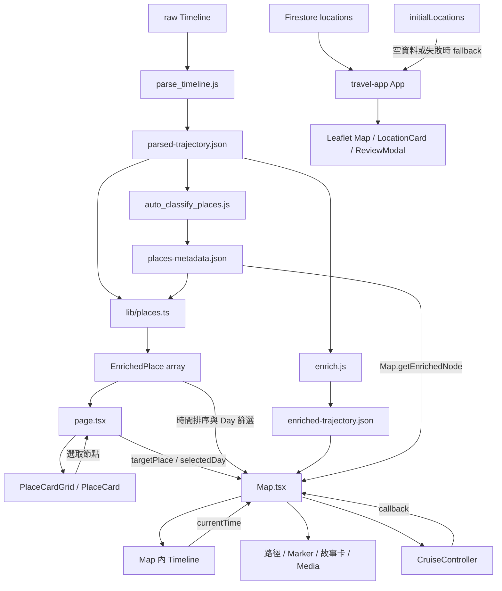

# Current-State Architecture

核對日期：2026-09-25。本文件記錄本地程式與資料；不聲稱正式部署或外部服務已驗證。

## 文件分工

根目錄 [ARCHITECTURE.md](../ARCHITECTURE.md) 保留原有設計背景、UI 演進與決策敘述；此處以來源引用補充目前實作，不重抄歷史敘事。Accepted Domain Model v1 見 [DOMAIN_MODEL.md](DOMAIN_MODEL.md)；尚未決定的 schema 與實作限制見 [CURRENT_TASK.md](CURRENT_TASK.md)。

## 應用與技術堆疊

| 應用 | Current State | 來源 |
| --- | --- | --- |
| portal-web | Next.js App Router、React、TypeScript、Tailwind CSS、Mapbox GL／react-map-gl、Turf、Lucide；首頁是 client component | [package.json](../portal-web/package.json)、[page.tsx](../portal-web/src/app/page.tsx) |
| travel-app | Vite、React、TypeScript、Tailwind CSS、Leaflet／react-leaflet、Firebase、圖片壓縮 | [package.json](../travel-app/package.json)、[App.tsx](../travel-app/src/App.tsx) |

精確套件版本以 package／lock 檔為準。兩個 README 主要保留框架啟動說明：[portal README](../portal-web/README.md)、[travel-app README](../travel-app/README.md)，不是完整產品規格。未找到 portal 的 Supabase client 或已實作的 Place／Visit 資料存取層。

## 資料來源與離線處理

| 資料／程序 | Current State |
| --- | --- |
| [raw/Timeline.json](../portal-web/src/data/raw/Timeline.json) | 原始 startTime、endTime、visit、activity、timelinePath。visit 包含候選 placeID、placeLocation、hierarchyLevel、probability。 |
| [parse_timeline.js](../portal-web/scripts/parse_timeline.js) | 篩選 2026/8/14–8/21 起始紀錄；activity/path/visit 產生軌跡點；每筆 visit 產生 node-N。座標由 geo:lat,lng 轉成 [lng,lat]。 |
| [parsed-trajectory.json](../portal-web/src/data/parsed-trajectory.json) | FeatureCollection；根層 startTime/endTime/times；trajectory LineString 與 video-node Points。parser 不保留節點的原始 placeID、離開時間或階層；node-N 由讀取順序產生。 |
| [enrich.js](../portal-web/enrich.js) | 加工軌跡：長距離大圓線、中距離 driving Directions、短距離端點連線，依距離插值時間。含本機絕對路徑，非通用建置管線。 |
| [enriched-trajectory.json](../portal-web/src/data/enriched-trajectory.json) | 加密軌跡及時間序列；此處 enriched 指路徑加工，不是 EnrichedPlace。 |
| [places-metadata.json](../portal-web/src/data/places-metadata.json) | 以 node-N 為 key 的內容資料：title、description、category、tags、isHighlight、media。 |
| [auto_classify_places.js](../portal-web/scripts/auto_classify_places.js) | 只補不存在的 metadata；按標題關鍵字分類，未命中預設 spot；預設媒體來自 feature。不是每次讀取時自動執行。 |

上述腳本未接入 portal package.json 的 build script。本次沒有執行任何產生／寫回資料的腳本。

2026-09-25 快照：parsed 與 enriched 各有 35 個節點且節點內容相同；軌跡時間點分別為 382／24,852 個。metadata 35 筆，spot 34、transit 1、Highlight 4；食宿類別雖受型別與 UI 支援，這份 metadata 沒有 food／stay。數量是資料快照，不是系統限制。

## Current-State Data Flow

## JSON 與 EnrichedPlace 的關係

[lib/places.ts](../portal-web/src/lib/places.ts) 的 `enrichFeatureNode` 以 feature.properties.id 查 metadata 外層 key；metadata 內重複的 id 不參與 join。

- id、coordinates、timestamp 來自節點。
- title／description：metadata 優先，再退回 feature；空字串也會 fallback。
- category：metadata → feature → other；tags：metadata → []；isHighlight：metadata → false。
- media：metadata 非空陣列優先；否則由 feature.youtubeId 或 imageUrl 建立。parser 的 youtubeId 是固定預設值，不能據此認定存在實拍影片。
- formattedTime、dateStr、dayNumber、coverImageUrl 在讀取時推導。
- getAllEnrichedPlaces(true)：Highlight 優先，同組按 timestamp 升冪；false 保留 feature 陣列順序，Map 再自行按時間排序。
- getDaysSummary：依 dayNumber 聚合；placeCount 是節點筆數；當日 endTime 是最後一個節點的抵達時間，不是最後離開時間。
- getUniqueTags：計算節點上的標籤出現次數，未對場所去重。

Day 是「有有效節點日期」排序後編號，不是從出發日起算的日曆天差。在台灣時區下，目前資料 8/20 無節點，8/21 為 Day 7。getDateStr／formatTimestamp 未指定固定 timeZone，取決於執行環境。

## 重要元件與資料使用

| 元件／功能 | 資料與行為 |
| --- | --- |
| [page.tsx](../portal-web/src/app/page.tsx) | 維護 viewMode、selectedPlace、selectedDay、category、tag；初始從 URL 讀取，狀態變更寫回 URL。 |
| [PlaceCardGrid](../portal-web/src/components/PlaceCardGrid.tsx) | Day × category × tag 交集篩選，保留清單排序；計算 Day 與標籤摘要。 |
| [PlaceCard](../portal-web/src/components/PlaceCard.tsx) | 讀整個 EnrichedPlace，顯示封面、時間、內容、標籤與媒體提示；選取時傳回整個物件。 |
| [Map](../portal-web/src/components/Map.tsx) | 圖層與路徑讀 enriched JSON；巡航清單透過 lib 讀 parsed JSON。另有 getEnrichedNode 合併 metadata，並建立 PopupInfo。存在兩套合併路徑。 |
| Timeline | 位於 Map 內，不是獨立元件；根層軌跡時間或 DaySummary 決定拉桿範圍；currentTime 驅動路徑插值與節點出現。 |
| Cruise | Map 管理時間序列、到站、五秒閱讀駐留與上一／下一站；不是只停 Highlight。五秒是 UI 播放時間，不是旅客停留長度。 |
| [CruiseController](../portal-web/src/components/CruiseController.tsx) | 顯示傳入的站名、索引、總數、Day、播放狀態並發送 callback；不自行讀 JSON。 |
| Media | Map 依 type 呈現 YouTube iframe、image 或 external-video 外連；陣列 index 決定媒體順序。 |
| [OptimizedImage](../portal-web/src/components/OptimizedImage.tsx) | 原生 img 的載入、失敗與 fallback UI；不是圖片代理或後端轉檔服務。 |

清單封面選擇：第一張 image → YouTube 縮圖 → feature imageUrl／youtubeId → 預設圖。Map 初始媒體使用陣列第一筆；手機 Peek 使用第一筆 thumbnail 或 url，兩者不保證與清單封面一致。

Day 在清單、巡航與播放範圍間共享；category／tag 沒有傳給 Map。地圖節點只用 nodeTime <= currentTime 過濾，軌跡也從全程開頭累積，不會因選定 Day 就移除之前所有點。

## travel-app 獨立資料流

[App](../travel-app/src/App.tsx) 讀 Firestore locations，空資料／失敗則讀 [initialLocations](../travel-app/src/data/initialLocations.ts)。[ReviewModal](../travel-app/src/components/ReviewModal.tsx) 讀寫 locations/{id}/reviews，照片上傳 Firebase Storage，留言時間使用 serverTimestamp。未找到與 portal node 的對照。外部資料、部署、規則與授權設定：Unknown，未做線上驗證。

## 既有文件與實作的差異／閱讀限制

| 既有敘述 | 核對結果 |
| --- | --- |
| PHASE_8_DB_SCHEMA 宣稱引入 Supabase，描述 trips／places／visits／visit_media 與 JOIN | 屬 schema 設計提案；Domain Model v1 已 accepted，但目前 portal 仍同步 import JSON，schema、欄位、權限與 migration 尚未決定或實作。 |
| 該文件稱只替換 lib/places.ts 即可讓畫面不用修改 | 不足以涵蓋現況：Map 直接 import enriched JSON 與 metadata，另有合併函式。未證明單換 lib 可完成整體遷移。 |
| 根 ARCHITECTURE 稱 GeoJSON 是純地理資訊 | 節點實際還有 title、description、youtubeId、timestamp；這是檔案分工，不是 Place／Visit 已分離。 |
| 分天／分段巡航 | 巡航站點與時間範圍確實分天，但圖層累積顯示之前資料；不可擴讀為整張地圖隔離當日內容。 |
| URL「雙向綁定／所見即分享」 | 可確認初始讀 URL、狀態寫回；不含 node 選取、播放進度、媒體索引。未見對所有後續外部 URL 變化重新套用 state 的邏輯。 |
| OptimizedImage 被稱為「圖片代理」 | 實作是前端 img 包裝，沒有代理 endpoint。 |
| 不使用 setInterval 的動畫敘述 | 軌跡播放用 requestAnimationFrame；Cruise 駐留倒數另外使用 setInterval，兩者需區分。 |
| 載具依交通方式切換 | 實際 isFlight 以加工後相鄰點距離 > 3 公里推定，不讀原始 activity.topCandidate.type。 |

這些差異記錄於此供後續核對；本次保留所有既有文件，不自行改寫歷史決策。
