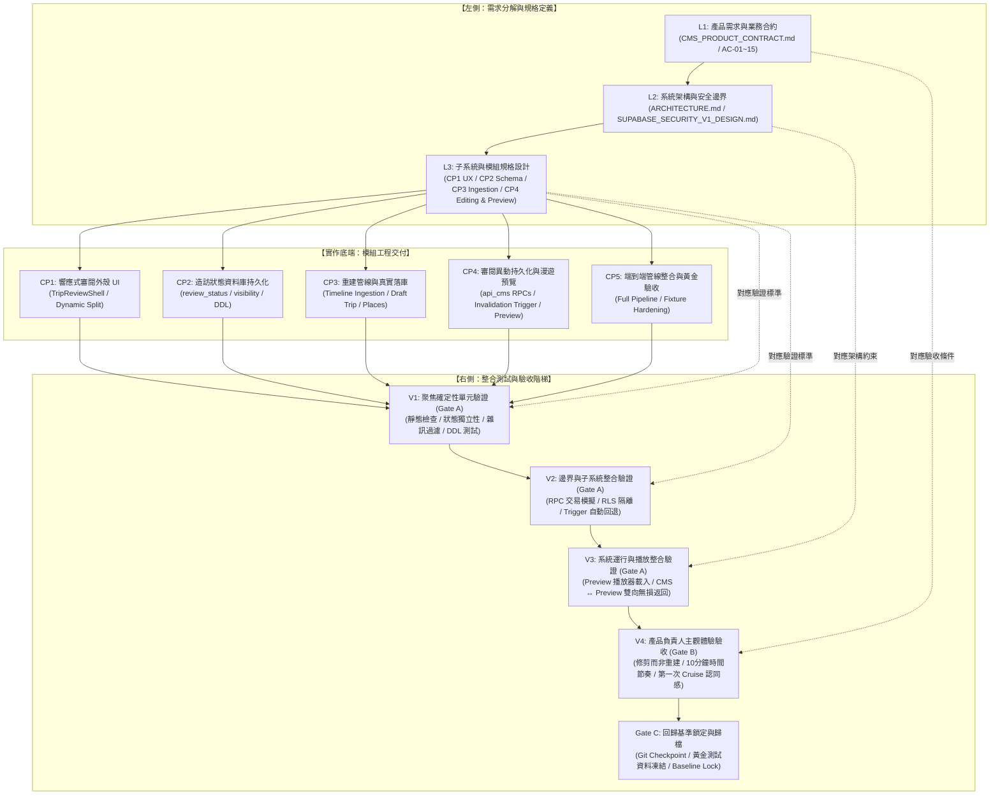

# Travel Portal CMS VS1 — V-Model 開發與驗證整合計畫 (PLAN.md)

**文件狀態：** 正式專案治理與驗證藍圖 (Canonical V-Model Plan)<br/>
**當前里程碑：** CMS Vertical Slice 1 (VS1) — 從建立行程到第一次漫遊預覽 (Create Trip to First Cruise Preview)
**關聯核心文件：**
- 需求合約：[`docs/CMS_PRODUCT_CONTRACT.md`](file:///d:/AI/SynologyDrive/travel/docs/CMS_PRODUCT_CONTRACT.md)
- 互動契約：[`docs/CMS_RESPONSIVE_UX_CONTRACT.md`](file:///d:/AI/SynologyDrive/travel/docs/CMS_RESPONSIVE_UX_CONTRACT.md)
- 驗收矩陣：[`docs/CMS_VS1_VERIFICATION_MATRIX.md`](file:///d:/AI/SynologyDrive/travel/docs/CMS_VS1_VERIFICATION_MATRIX.md)
- 狀態追蹤：[`docs/CMS_CURRENT_STATUS.md`](file:///d:/AI/SynologyDrive/travel/docs/CMS_CURRENT_STATUS.md)
- 當前檢查點：[`docs/CMS_CURRENT_CHECKPOINT.md`](file:///d:/AI/SynologyDrive/travel/docs/CMS_CURRENT_CHECKPOINT.md)

---

## 1. V-Model 架構總覽

本專案採嚴謹的 **雙軌 V-Model**，將 CMS VS1 的水平開發檢查點（CP1 ~ CP5）精確對應至垂直的系統分解層級與驗證階梯，嚴格落實 **「機器驗證（Gate A）不等於產品驗收（Gate B）」** 的治理原則。



---

## 2. V-Model 節點與 Checkpoint 雙向映射表

| V-Model 層級 | 對應節點名稱 | 負責 Checkpoint | 交付檔案 / 實作成果 | 驗證標準與階梯 | 當前狀態 |
| :--- | :--- | :--- | :--- | :--- | :--- |
| **L1 需求層** | 產品合約與驗收矩陣 | 全域 (CP1~CP5) | `CMS_PRODUCT_CONTRACT.md`<br/>`CMS_VS1_VERIFICATION_MATRIX.md` | AC-01 ~ AC-15 驗收標準定義 | **基準已確立** |
| **L2 架構層** | 安全與資料庫架構 | CP2, CP3, CP4 | `SUPABASE_SCHEMA_V1_SPEC.md`<br/>`SUPABASE_SECURITY_V1_DESIGN.md`<br/>`docs/SECRET_BOUNDARY.md` | 私密軌跡不外洩、Draft Trip 不滲漏至 `api_public`、Tier 0~3 權限防護 | **架構已鎖定** |
| **L3 規格層** | CP1 響應式互動契約 | **CP1** | `docs/CMS_RESPONSIVE_UX_CONTRACT.md` | 手機優先漸進揭露、桌面 4 欄佈局、單一審閱流 | **PO 驗收通過** |
| **L3 規格層** | CP2 造訪狀態規格 | **CP2** | `docs/CMS_SCHEMA_CHECKPOINT_2.md` | 4 態完全獨立、向下相容 backfill、安全性視圖 | **機器驗證通過** |
| **L3 規格層** | CP3 重建導入規格 | **CP3** | `docs/CMS_CURRENT_CHECKPOINT.md` | Google Timeline 解析、去雜訊、地點識別重用、草稿入庫 | **機器驗證通過** |
| **L3 規格層** | CP4 異動與預覽規格 | **CP4** | `docs/CMS_VS1_CP4_SPEC.md` | `api_cms` 異動 RPC、DB 異動失效 Trigger、草稿預覽 RPC、返回 CMS | **待執行 (Next)** |
| **L3 規格層** | CP5 端到端與黃金基準 | **CP5** | VS1 完工驗收規格書 | 端到端自動化、黃金資料集 (Golden Trip) 比對、回歸鎖定 | **待排程** |
| **實作底端** | CP1 UI 外殼工程 | **CP1** | `portal-web/src/app/cms/page.tsx`<br/>`portal-web/src/components/cms/*` | V3 響應式操作流驗證、V4 PO 人工驗收 | **`PRODUCT_ACCEPTED`** (Commit `cb16186`) |
| **實作底端** | CP2 Schema DDL 遷移 | **CP2** | `supabase/migrations/20261018000000_visit_state_schema_cp2.sql`<br/>`portal-web/src/lib/cms-schema-cp2.test.cjs` | V1 DDL 靜態檢查、狀態獨立性測試、Secret Scan 通過 | **`MACHINE_VERIFIED`** (Commit `adcef51`) |
| **實作底端** | CP3 導入管線實作 | **CP3** | `portal-web/src/lib/cms/reconstruction.ts`<br/>`portal-web/src/lib/cms/persist-ingestion.ts`<br/>`portal-web/scripts/cms-ingest-timeline.mjs` | V1 核心單元測試、V2 真實 Golden Trip 入庫驗證 (25 地點、29 造訪、軌跡採樣) | **`MACHINE_VERIFIED`** (Commit `a7dc704`) |
| **實作底端** | CP4 編輯與預覽實作 | **CP4** | `supabase/migrations/*_cp4.sql`<br/>`portal-web/src/lib/cms/cms-api.ts`<br/>`portal-web/src/app/cms/preview/[tripSlug]/page.tsx` | V1 RPC 單元測試、V2 Trigger 狀態轉換整合、V3 預覽載入與無損返回 | **待實作** |
| **實作底端** | CP5 完整整合與防護 | **CP5** | `portal-web/src/lib/cms-e2e.test.cjs`<br/>回歸套件升級 | V1~V3 全套自動化、V4 PO 完整走查、Gate C 基準凍結 | **待實作** |

---

## 3. 各 Checkpoint 詳細執行與驗證節點 (CP1 ~ CP5)

### CP1 — 響應式審閱外殼 (Responsive Trip Review Shell)
- **V-Model 節點：** L3 (UX Contract) ➔ 實作底端 (UI Prototype) ➔ R3 (V3 Runtime) ➔ R4 (V4 PO Acceptance)
- **達成狀態：** `PRODUCT_ACCEPTED`（已通過 Product Owner 人工驗收，嚴禁倒退或擅自改版）
- **核心交付：**
  - 行程審閱核心鏈路：`Trip → Day → Visit → Detail → Confirm → Preview`。
  - 行動版漸進式展開（BottomSheet 地圖）與桌面版 4 欄平衡佈局（常駐地圖 1/4 ~ 1/3，編輯展開 2/3 ~ 3/4）。
  - 明確使用者操作：`Confirm`（確認並自動跳至下一 Pending）、`Undo`（撤銷回 Pending）、必要待辦事項（Required Issues）橫幅。
- **存檔 Commit：** `cb16186`

---

### CP2 — 造訪狀態資料庫持久化 (Visit State Persistence)
- **V-Model 節點：** L2/L3 (Schema Spec) ➔ 實作底端 (DDL & View) ➔ R1 (V1 Static DDL & Unit Tests) ➔ R2 (V2 RLS & Migration Boundary)
- **達成狀態：** `MACHINE_VERIFIED`
- **核心交付：**
  - Migration: `20261018000000_visit_state_schema_cp2.sql`。
  - 新增 `review_status` (`pending`, `confirmed`) 與 `visibility` (`public`, `private`)。
  - 保留舊有 `publication_status` 作為向下相容欄位，確保不破壞讀者端 RLS 與既有視圖。
  - 更新 `api_cms.cms_visits` 安全調用者視圖。
- **驗證成果：**
  - 5/5 Node 測試、PowerShell DDL 測試全數 PASS。
  - 4 態完全獨立驗證通過。
  - Secret Scan 零洩漏，Secret Boundary 6/6 PASS。
- **存檔 Commit：** `adcef51`

---

### CP3 — 重建導入管線整合 (Reconstruction Ingestion Integration)
- **V-Model 節點：** L2/L3 (Ingestion Spec) ➔ 實作底端 (Reconstruction Engine & Persistence) ➔ R1 (V1 Noise & Range Filter) ➔ R2 (V2 DB Persistence)
- **達成狀態：** `MACHINE_VERIFIED`
- **核心交付：**
  - `reconstruction.ts`：行程日期範圍過濾、小於 3 分鐘雜訊過濾、重訪地點識別與重用、時序異常標記。
  - `persist-ingestion.ts`：原子化寫入 `app.trips` (Draft)、`app.places`、`app.visits` (預設 `pending` + `public`)、`app.trajectories`、`app.trajectory_samples`、`app.trajectory_source_records`。
  - `cms-ingest-timeline.mjs`：提供可重複執行的受信任導入 CLI。
- **驗證成果：**
  - 48/48 測試全數通過（含 9 個重建管線單元測試）。
  - 真實日本黃金行程導入成功：建立 1 個草稿行程、25 個真實地點、29 個待審閱造訪、1 條私密軌跡及 250 筆軌跡取樣。
  - 嚴格遵守私密邊界：原始 GPS/時間戳記完整保留於 trusted 儲存層，不對外洩漏。
- **存檔 Commit：** `a7dc704`

---

### CP4 — 審閱異動持久化與第一次漫遊預覽 (Live Review Persistence & Cruise Preview)
- **V-Model 節點：** L3 (Mutation & Preview Spec) ➔ 實作底端 (RPCs, Invalidation Trigger, Preview Route, UI Wiring) ➔ R1 (V1 RPC Unit Tests) ➔ R2 (V2 DB Integration) ➔ R3 (V3 Preview Playback & Round Trip)
- **目前狀態：** **即將執行 (Active Checkpoint)**
- **主要任務範疇：**
  1. **資料庫層遷移 (`20261018000001_cms_editing_and_preview_cp4.sql`)：**
     - 審閱操作 RPC：`api_cms.update_cms_visit`、`api_cms.confirm_cms_visit`、`api_cms.undo_cms_visit`、`api_cms.add_cms_visit`。
     - 資料庫觸發器 (DB Trigger)：任何已確認 (`confirmed`) 的造訪，若地點、時間、標題或可見性發生結構性異動，自動強制回退為待審閱 (`pending`)。
     - 預覽專用安全 RPC：`api_cms.get_draft_preview_visits`（僅過濾 `confirmed` + `public`）、`api_cms.get_draft_preview_trajectory`（對齊 `get_public_trajectory` 幾何規格）。
     - 完全隔離：`api_public.*` 不做任何修改，草稿行程絕對不對公眾讀者洩漏。
  2. **CMS 審閱外殼真實串接：**
     - 將 CP1 記憶體狀態替換為呼叫 `api_cms` RPCs。
     - 地點校正優先支援行程內已辨識地點（25 個地點）與鄰近候選地點，支援地圖點擊自選座標（不引入外部付費 API）。
  3. **第一次漫遊預覽路由 (`/cms/preview/[tripSlug]`)：**
     - 獨立預覽路由，重用讀者端 Cruise 播放器與認證預覽轉接器 (Preview Adapter)。
     - 進入門檻：至少 1 筆 `confirmed` + `public` 造訪且具備有效軌跡。
     - 懸浮控制項：「返回編輯 (Back to CMS)」，返回時完整保留 URL 參數（當前日期 `day` 與選中造訪 `selectedVisit`），保證狀態無損。
- **機器驗證門檻 (Gate A)：**
  - AC-07 (地點校正)、AC-08 (新增造訪)、AC-09 (時間順序與回退觸發器)、AC-10 (可見性)、AC-11 (確認邏輯)、AC-13 (漫遊預覽門檻)、AC-14 (CMS ↔ Preview 雙向返回)。
  - 全套自動化單元與整合測試通過、TypeScript 0 錯誤、Secret Scan PASS。

---

### CP5 — 端到端管線整合與黃金驗收 (Full Pipeline & Golden Trip Acceptance)
- **V-Model 節點：** R3 (V3 System Integration) ➔ R4 (V4 PO Real Walkthrough) ➔ R5 (Gate C Baseline Lock)
- **目前狀態：** 待排程 (Scheduled after CP4)
- **主要任務範疇：**
  1. 完整流程串接驗證：Timeline JSON 導入 ➔ CMS 審閱與修剪 ➔ 逐日確認 ➔ 進入 Preview 漫遊播放 ➔ 返回調整。
  2. 交付產品負責人 (Product Owner) 進行黃金行程真實走查 (Gate B)。
  3. 驗證四大感受指標：
     - 修剪而非重建 (Trim rather than rebuild)。
     - 10 分鐘時間顯示節奏易於理解。
     - 地點校正與新增負擔極低。
     - 第一次 Cruise 具備強烈「這就是我的真實旅行」認同感。
  4. 通過後正式打上 `PRODUCT_ACCEPTED`，將 Golden Fixture 寫入回歸測試，鎖定 Git Checkpoint (Gate C)。

---

## 4. 三門禁驗收機制 (Gate Philosophy)

```text
[程式碼/遷移完成]
       │
       ▼
┌──────────────────────────────────────────────┐
│ Gate A — 機器可驗證門檻 (Machine Verified)    │
│  - 自動化單元與整合測試 (npm test)          │
│  - 靜態型別安全檢查 (npx tsc --noEmit)        │
│  - 資安與環境變數掃描 (qa:secret-scan)       │
│  - 讀者端回歸測試無損 (qa:public-playback)   │
└──────────────────────────────────────────────┘
       │ PASS
       ▼ 僅解鎖狀態：READY_FOR_PRODUCT_OWNER_ACCEPTANCE
┌──────────────────────────────────────────────┐
│ Gate B — 產品負責人人工驗收 (PO Acceptance)  │
│  - 真實行程端到端操作體驗走查                 │
│  - 修剪負荷與時間編輯合理性確認               │
│  - 第一次 Cruise 沉浸感評估                  │
└──────────────────────────────────────────────┘
       │ ACCEPT
       ▼ 獲准狀態：PRODUCT_ACCEPTED
┌──────────────────────────────────────────────┐
│ Gate C — 回歸基準鎖定 (Regression Baseline) │
│  - 建立專用 Git Checkpoint Commit            │
│  - 固化 Golden Fixture 與回歸測試保護         │
│  - 更新專案記憶庫 (docs/CURRENT_STATUS.md)   │
└──────────────────────────────────────────────┘
```

---

## 5. 異常分類與自主修復預算 (Autonomous Repair Protocol)

當右側驗證節點出現紅燈時，必須先嚴格分類再行動：
1. **PRODUCT_REGRESSION（技術回歸/Bug）：** 預期行為明確，由 Agent 在既有架構下自主修復。單一回歸最多嘗試修復 2 次，單一 Checkpoint 最多 3 個修復週期。
2. **RECONSTRUCTION_QUALITY（重建品質）：** 召回率/精確率未達預期，必須依真實資料調優啟發式邏輯，不得擅自修改業務合約。
3. **USABILITY（易用性問題）：** 操作流程反直覺或摩擦力過大，需提出具體方案交由 PO 裁決。
4. **PRODUCT_DECISION_REQUIRED（產品決策中斷）：** 涉及未決之資料庫綱要變更、領域模型定義或權限邊界時，**立即停下回報，嚴禁自主推演**。
