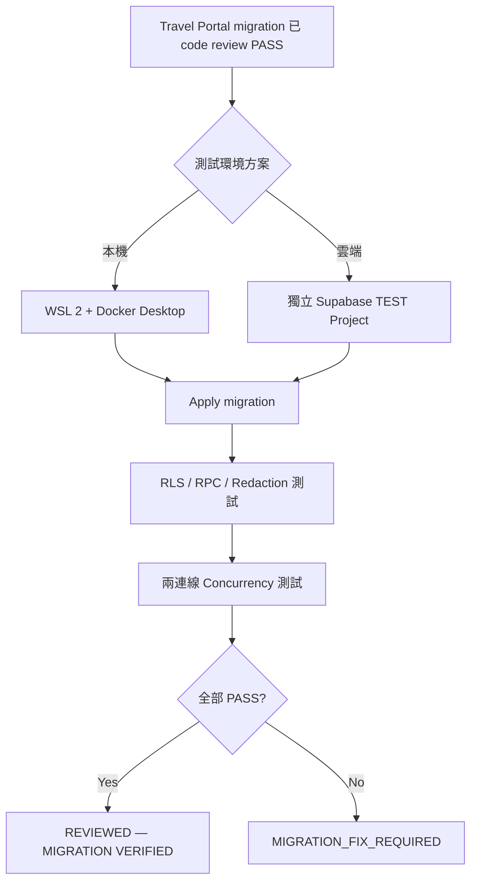

# Windows 上安裝 WSL、Docker Desktop 與 Supabase 測試環境分析

## Executive Summary

以你目前的電腦狀況 **C: 尚餘約 70 GB、D: 僅餘約 8 GB，而且尚未安裝 WSL**，技術上完全可以安裝 **WSL 2 + Docker Desktop + 本機 Supabase**；Docker 官方目前要求 WSL 2.1.5 以上、硬體虛擬化、64-bit CPU/SLAT 與至少 8 GB RAM，而 Supabase 官方則要求本機開發具備 Docker-compatible container runtime。citeturn17view0turn16search2

不過，**你不需要為 Docker 安裝 Ubuntu**：Microsoft 支援 `wsl --install --no-distribution`，Docker 也明確說 WSL 2 backend 不需要特定 Linux distribution；若目標只是讓 Docker/Supabase 運作，這是較省空間的方案。citeturn14view0turn17view1

對你的磁碟配置，我建議 Docker 資料**留在 C 槽，不要搬到只剩 8 GB 的 D 槽**。Supabase 官方沒有公布第一次 `supabase start` 的固定下載 GB 數，只說首次啟動會拉取所需 Docker images；實務上我建議把 **約 5–10 GB 額外 Docker/Supabase 磁碟使用量視為規劃估算，並保留至少 15–20 GB 安全餘裕**，這是保守工程估算，不是 Supabase 官方保證值。citeturn16search6turn16search2

但若你目前目的只是把 Travel Portal 的這一版 migration 做一次 runtime verification，**獨立 Supabase test project 也是很合理、甚至更省事的選擇**；Supabase 官方本身就建議 staging 與 production 使用不同 project。citeturn21view5

## 前提條件與檢查

在碰 WSL 或 Docker 前，我建議先做一次「只讀檢查」。以下指令不會修改系統。

**以系統管理員身分開 PowerShell**，先執行：

```powershell
# Windows 版本 / Build
Get-CimInstance Win32_OperatingSystem |
    Select-Object Caption, Version, BuildNumber, OSArchitecture

# CPU 架構、硬體虛擬化與 SLAT
Get-CimInstance Win32_Processor |
    Select-Object Name, AddressWidth, VirtualizationFirmwareEnabled, SecondLevelAddressTranslationExtensions

# RAM
Get-CimInstance Win32_ComputerSystem |
    Select-Object @{Name="RAM_GB";Expression={[math]::Round($_.TotalPhysicalMemory / 1GB, 1)}}

# 磁碟剩餘空間
Get-PSDrive -PSProvider FileSystem |
    Select-Object Name,
        @{Name="UsedGB";Expression={[math]::Round($_.Used / 1GB, 1)}},
        @{Name="FreeGB";Expression={[math]::Round($_.Free / 1GB, 1)}}

# Windows 的 Hyper-V / virtualization requirement 摘要
systeminfo.exe
```

Docker Desktop 目前 WSL 2 backend 文件列出的核心硬體條件包括 **64-bit CPU、SLAT、8 GB RAM、BIOS/UEFI hardware virtualization 啟用**，且要求 WSL 2.1.5 以上；目前官方列出的 Windows 基準是 Windows 10 22H2 build 19045，以及 Windows 11 23H2 build 22631 或更高的受支援版本。citeturn17view0

你也可以按：

> `Ctrl + Shift + Esc` → 效能 → CPU

查看 Windows 是否顯示：

```text
Virtualization: Enabled
```

如果是 Disabled，問題不是 PowerShell，而是 BIOS/UEFI。Microsoft 官方的流程是進入 Windows「系統 → 復原 → 進階啟動 → UEFI Firmware Settings」，再依電腦廠商開啟 Intel VT-x/VMX 或 AMD-V/SVM。Microsoft 特別提醒只修改必要的 UEFI 設定。citeturn18search4

**管理員權限的需求要分兩件事看。**第一次啟用 WSL 2 屬於 machine-level 系統變更，需要 Administrator；但 Docker Desktop 現在建議多數個人使用者採 **per-user installation**，Docker 本身的安裝與更新可以不需要管理員權限。citeturn17view0

你不必為了 Docker 刻意啟用完整 Hyper-V。Docker 目前預設並推薦大多數使用者使用 **WSL 2 backend**；Hyper-V 是另一種 backend，而且完整 Hyper-V role 在 Windows Home 無法安裝。citeturn17view0turn23view0

以你的 Travel Portal 需求來說：

| 檢查 | 建議 |
|---|---|
| Windows 10/11 64-bit | 必須確認 |
| Hardware Virtualization | 必須 Enabled |
| SLAT | 必須 |
| RAM | Docker 官方至少 8 GB |
| C: free 70 GB | **足夠** |
| D: free 8 GB | **不適合作 Docker data root** |
| Administrator | WSL 首次設定需要 |
| 完整 Hyper-V | **WSL 2 backend 不需要刻意安裝** |
| Ubuntu / Debian | **Docker 不強制需要** |

Docker 的 Windows Home 限制主要在 **Windows containers**；Supabase 使用的是 Linux containers，因此你沒有必要開 Windows Containers。Docker 安裝器甚至提供 `--no-windows-containers` 選項。citeturn17view0

## WSL 安裝與疑難排解

你現在看到的：

```text
未安裝 Windows 子系統 Linux 版。
您可以執行 'wsl.exe --install' 進行安裝。
```

是正常狀態。Microsoft 官方目前的標準方式就是在 Administrator PowerShell 執行 `wsl --install`，完成後重新啟動 Windows；預設做法還會安裝 Ubuntu。citeturn19search0

但就你的情況，我會稍微改成**最小化版本**。

**只為 Docker 安裝 WSL，不額外安裝 Ubuntu：**

```powershell
wsl --install --no-distribution
```

Microsoft 的 WSL CLI 官方文件明確支援 `--no-distribution`；Docker 也明確表示 Docker Desktop 的 WSL 2 backend **不要求你另外安裝某個 Linux distribution**，而且 Windows terminal 可以直接使用 `docker`。citeturn14view0turn17view1

安裝結束如果 Windows 要求重新啟動：

```powershell
Restart-Computer
```

重新登入 Windows 後，再執行：

```powershell
wsl --update
wsl --set-default-version 2

wsl --version
wsl --status
wsl --list --verbose
```

`wsl --update` 更新 WSL；`wsl --set-default-version 2` 讓之後新安裝的 distribution 預設使用 WSL 2；`wsl --version`、`wsl --status` 與 `wsl -l -v` 分別用來看 WSL 元件版本、整體狀態和各 Linux distribution 的版本。citeturn14view0

理想上你會看到類似：

```text
WSL version: 2.x.x
Kernel version: ...
WSLg version: ...
```

Docker 目前最低要求 WSL **2.1.5**；若版本更舊，就再執行：

```powershell
wsl --update
```

citeturn17view0turn16search5

你之後若真的想要 Linux shell，再另外安裝即可，不需要現在先吃掉空間：

```powershell
wsl --list --online
```

例如：

```powershell
wsl --install -d Ubuntu
```

Microsoft 支援用 `--list --online` 查看可用 distribution，再用 `wsl --install -d <Distribution>` 選擇；也支援 `--location` 指定 distribution 位置。citeturn14view0

**如果自動安裝失敗，才做 manual feature repair。**首先可明確啟用 Virtual Machine Platform：

```powershell
dism.exe /online /enable-feature /featurename:VirtualMachinePlatform /all /norestart
```

若是較舊或異常的 Windows WSL configuration，也可以確認 WSL optional component：

```powershell
dism.exe /online /enable-feature /featurename:Microsoft-Windows-Subsystem-Linux /all /norestart
```

之後：

```powershell
Restart-Computer
```

正常的新式 `wsl --install` 會自動處理所需 Windows features，因此**不要一開始就手動把所有 virtualization feature 全開**。Microsoft 的標準單指令安裝流程本身就是 `wsl --install`。citeturn19search0

常見故障可這樣判讀：

| 現象 / Error | 最可能原因 | 建議處理 |
|---|---|---|
| `0x80370102` | VMP 未啟用或 BIOS virtualization 關閉 | 啟用 Virtual Machine Platform、確認 BIOS virtualization，再重啟 |
| `0x80370102` 且上述均正常 | Hypervisor boot 被關閉 | 檢查 `bcdedit` |
| `wsl --version` 無完整版本資訊 | WSL 太舊 / inbox version | `wsl --update` |
| Microsoft Store 被公司政策擋住 | Store 路徑不可用 | 可用 `--web-download` 或官方 MSI 路徑 |
| Docker 安裝後無法起 WSL backend | WSL/virtualization 先決條件未完成 | 先確認 `wsl --version`、`wsl --status` |
| VMware/VirtualBox 異常 | 與 Windows hypervisor interaction 有關 | 更新到支援現代 Hyper-V/WSL 的版本 |

其中 `0x80370102`，Microsoft 官方明確要求檢查 Virtual Machine Platform 與 BIOS virtualization。如果兩者已開仍失敗，可在 Administrator PowerShell 執行：

```powershell
bcdedit /enum | findstr -i hypervisorlaunchtype
```

如果顯示：

```text
hypervisorlaunchtype    Off
```

改成：

```powershell
bcdedit /set hypervisorlaunchtype Auto
Restart-Computer
```

這就是 Microsoft WSL troubleshooting 提供的正式解法。citeturn19search1

完整 **Hyper-V** 則是另一回事。你只有在明確決定不用 WSL 2、改採 Hyper-V backend，而且 Windows edition 支援時才需要：

```powershell
Enable-WindowsOptionalFeature -Online -FeatureName Microsoft-Hyper-V -All
```

Microsoft 指出完整 Hyper-V role 只適用於 Windows Pro/Enterprise 等支援 edition，Windows Home 不能安裝；Docker 也把 WSL 2 backend 當成預設 backend。citeturn23view0turn17view0

## Docker Desktop 安裝與 Supabase 本機空間策略

Docker Desktop 應只從 **Docker 官方 Windows 安裝頁或 Microsoft Store** 下載；官方目前提供 Windows x86_64 installer，以及 Arm 版本。一般 Intel/AMD Windows PC 通常使用 x86_64。citeturn17view0

下載前可以看：

```powershell
$env:PROCESSOR_ARCHITECTURE
```

一般若得到：

```text
AMD64
```

就用 x86_64 installer。

Docker 官方現在建議大多數使用者採 **per-user installation**；其預設安裝位置是：

```text
%LOCALAPPDATA%\Programs\DockerDesktop
```

而不是全系統的 `C:\Program Files\Docker\Docker`。Per-user 模式不需要 admin 安裝/更新，而且 WSL 2 backend 足以涵蓋大多數 Docker Desktop 使用案例。citeturn17view0

最簡單是雙擊：

```text
Docker Desktop Installer.exe
```

安裝畫面選：

```text
Per-user
WSL 2 backend
Linux containers
```

不要為 Travel Portal 開 Windows Containers。

如果要用 PowerShell，建議**普通使用者 PowerShell**執行 per-user installer：

```powershell
Set-Location "$env:USERPROFILE\Downloads"

Start-Process '.\Docker Desktop Installer.exe' `
    -Wait `
    -ArgumentList 'install', '--user', '--backend=wsl-2', '--no-windows-containers'
```

這些 installer flags 都是 Docker 官方目前支援的選項。citeturn17view0

安裝完成後，**Docker Desktop 不一定會自行啟動**。從開始功能表啟動 Docker Desktop，接受使用條款，等 Engine ready。Docker 官方說明個人使用、教育、非商業 OSS，以及符合規模條件的小型企業可免費使用 Docker Desktop；較大型企業及政府使用情境則可能需要付費授權。citeturn17view0

進入：

```text
Docker Desktop
→ Settings
→ General
```

確認：

```text
Use WSL 2 based engine
```

Docker 表示支援 WSL 2 的系統通常預設已開啟這項設定。citeturn17view1

然後回 PowerShell：

```powershell
docker version
docker ps
```

正常時，`docker version` 應同時看到 Client 與 Server；`docker ps` 即使目前沒有 container，也應該只是空表，而不是：

```text
Cannot connect to the Docker daemon
```

Docker WSL backend 啟動後，官方指出 Windows terminal 可直接使用 Docker commands；不需要先進 Ubuntu。citeturn17view1

**你的 data root 最重要。**Docker WSL 2 engine 預設資料位置是：

```text
C:\Users\User\AppData\Local\Docker\wsl
```

Docker 官方支援在：

```text
Settings
→ Resources
→ Advanced
```

調整資料位置；安裝器本身也有：

```text
--wsl-default-data-root=<path>
```

可指定 WSL distribution disk 位置。citeturn17view0turn16search1

但你的實際配置是：

```text
C: 70 GB free
D:  8 GB free
```

所以我的建議非常明確：

> **Docker Desktop + WSL Docker data 都留 C。不要搬 D。**

D 槽只剩 8 GB，反而比 C 更容易被 Docker images/volumes 填滿。Docker 支援搬 data root 並不代表「搬走一定比較好」；若目的地空間不足、磁碟不可用或搬移中發生問題，會讓 Docker runtime state 受到影響，這是基於 Docker data location 機制的直接工程風險推論。citeturn17view1turn17view0

你問的 **第一次 `npx supabase start` 到底會用多少空間**，這裡必須區分官方資料與估算。Supabase 官方只明確說「first run 會 pull Docker images，之後啟動會比較快」，以及本機完整 stack 需要 container runtime；官方沒有承諾一個固定 GB 數。citeturn16search6turn16search2

因此我會用以下**規劃估算**：

| 項目 | 規劃值 | 性質 |
|---|---:|---|
| WSL 本體 | 相對小 | 非主要空間來源 |
| Docker Desktop 程式 | 約數 GB 等級內 | 版本會變 |
| 第一次完整 Supabase image download | **數 GB，規劃抓約 3–6 GB network transfer** | 我的保守估算，非官方固定值 |
| Images 解壓 + writable layers + volumes | **規劃抓約 5–10 GB disk** | 我的工程估算 |
| 建議給 Docker/Supabase 的安全預算 | **10–15 GB** | 保守規劃 |
| 建議永遠保留的 C 槽 headroom | **至少 15–20 GB；我個人會抓 25–30 GB** | 操作安全線，非官方要求 |

你現在是 70 GB free，因此即使第一次本機 stack 使用 10 GB 左右，仍有約 60 GB；從單純磁碟容量來看，**可以安裝**。

而且還有一個進階省空間的方法：Supabase 官方目前 CI 文件已有：

```bash
supabase db start
```

這類 database-oriented workflow；如果第一階段只要測 migration/SQL/schema 行為，可以先採 DB-focused verification，再在真正需要 Auth/Data API integration 時啟完整 stack。citeturn21view4

不過你的 Travel Portal 最終還要測：

```text
auth.jwt()
RLS
PostgREST / Data API
api_public
api_cms
```

所以完整 hosted/local Supabase integration test 最後仍有價值。

## 最小化磁碟空間與清理策略

你先前量到：

```text
.pnpm   ≈ 0.89 GB
.cache  ≈ 1.39 GB
.codex  ≈ 0.88 GB
.vscode ≈ 0.49 GB
```

以及可疑的個人 `node_modules` 加起來不到約 1 GB。這表示你的 C 槽目前**沒有一個非常明顯的 20–30 GB Node dependency 黑洞**，所以不值得為了 Docker 冒險亂刪 `.codex`、VS Code 或系統軟體。

清理時建議由低風險到高風險進行：

| 操作 | 風險 | 可回復性 | 建議 |
|---|---|---|---|
| `pnpm store prune` | 很低 | 重新下載即可 | **推薦** |
| `npm cache verify` | 幾乎無 | 不需恢復 | **推薦** |
| `pip cache purge` | 很低 | 重新下載即可 | 可做 |
| 舊 project `node_modules` | 低～中 | 有 lockfile 即可重建 | 可選 |
| Python `.venv` | 中 | 有 requirements/lock 才好恢復 | 謹慎 |
| `.codex` / Codex runtime 手動刪 | 中 | 可能重下載或丟狀態 | **不建議** |
| `docker system prune` | 中 | images 可重抓；container state 不一定 | 看清單再做 |
| `docker system prune -a` | 中高 | 大量 images 要重抓 | 少用 |
| `docker system prune -a --volumes` | **高** | volume data 可能不可恢復 | **不可隨便執行** |

對你現有 pnpm store，第一個可以安全執行：

```powershell
pnpm store prune
```

pnpm 官方明確表示這會移除未被任何 project 引用的 store packages，對既有 project 不造成副作用；之後若又需要，pnpm 會重新下載。citeturn23view2

npm 建議先：

```powershell
npm cache verify
```

若你**確定是為了磁碟空間**才需要全部清：

```powershell
npm cache clean --force
```

npm 官方本身把 cache 設計成 self-healing，因此一般不鼓勵日常清空；`clean` 甚至要求 `--force`。換句話說，這是「空間真的需要時才做」，不是例行保養。citeturn23view3

Python pip：

```powershell
py -m pip cache dir
py -m pip cache info
```

確認後：

```powershell
py -m pip cache purge
```

pip 官方文件明確說 `purge` 會移除所有 pip cache items；代價主要是日後安裝時要重新下載。citeturn21view3

舊 Node project 如果有：

```text
package.json
package-lock.json
```

才建議刪：

```powershell
Remove-Item -Recurse -Force "C:\path\old-project\node_modules"
```

未來：

```powershell
Set-Location "C:\path\old-project"
npm ci
```

如果是 pnpm，而且有 lockfile：

```powershell
pnpm install --frozen-lockfile
```

這種清理的核心原則是：

> **刪可重建的 dependency artifact，不刪 dependency manifest / lockfile。**

而你先前看到：

```text
C:\Program Files\Adobe\...\node_modules
C:\Program Files (x86)\ASUS\...\node_modules
C:\Program Files\Razer\...\node_modules
C:\Program Files\Obsidian\...\node_modules
```

這些是安裝軟體本身的 runtime dependency，**不要手動清它們**；要省這部分空間，應該解除安裝整個不用的應用，而不是進程式目錄切掉其中一部分。

Docker 裝完後，首先永遠是：

```powershell
docker system df
```

它讓你先看 images、containers、volumes、build cache 用量，再決定清什麼；Docker 提供 `docker system df` 就是為了檢視 daemon 的 disk usage。citeturn3view3

比較溫和的是：

```powershell
docker system prune
```

Docker 官方指出它會刪除：

```text
stopped containers
unused networks
dangling images
unused build cache
```

但**預設不刪 volumes**，就是為了降低誤刪重要資料的風險。citeturn23view1

更積極：

```powershell
docker system prune -a
```

`-a` 會連所有「目前沒有 container 使用」的 images 都清掉，因此下次 Supabase 很可能需要重新下載 images。citeturn23view1

而這個：

```powershell
docker system prune -a --volumes
```

請把它視為**破壞性指令**。Docker 官方說 `--volumes` 會連未使用 anonymous volumes 一起 prune，volume 可能就是資料庫資料。citeturn23view1

Supabase 也有類似概念。單純：

```powershell
npx supabase stop
```

用來停止 local stack；如果使用會刪除本地 backup/volume 的選項，必須確定資料可丟棄。Supabase 的本機流程本來就把 local environment 當成可重建環境，因此真正重要的是 migration 和 seed 應進版本控制。citeturn16search2turn16search23

對你個人目前最合理的空間維護週期是：

```powershell
# 偶爾清 pnpm
pnpm store prune

# 檢查 npm，不一定真的清
npm cache verify

# Docker 每隔一段時間先看，不先刪
docker system df

# 確認沒有要保留的 stopped containers / build cache 才做
docker system prune
```

而不是每週固定跑：

```powershell
docker system prune -a --volumes
```

## 不安裝 Docker 的 Supabase Test Project 流程

這條路是**完全成立的**，而且對你眼前的 Travel Portal migration verification 特別合理。

Supabase 官方自己的 environments 文件就示範：

```text
local / feature
        ↓
staging project
        ↓
production project
```

並明確建議 staging 與 production 建立分離的 Supabase projects。citeturn21view5

你的情況可以簡化成：



**建立 test project。**進 Supabase Dashboard，建立一個全新 project；官方 quickstart 的第一步就是在 Dashboard 建新 project，SQL Editor 可以直接執行 SQL。citeturn22view4

我建議名稱刻意醒目：

```text
travel-migration-test-20260925
```

不要叫：

```text
travel
```

也不要和 production 名稱只差一個小字母。

使用：

- 完全不同的 DB password
- 完全不同 project ref
- **不放正式資料**
- test fixture 全部使用假資料
- agent 只取得 TEST credential

Supabase Free plan 截至目前提供 **500 MB database、5 GB egress、1 GB file storage，最多兩個 active free projects；Free project 一週沒有活動會暫停**。Pro 目前從每月 US$25 起，第一個 project 包含在方案內，額外 project 從 US$10/月起。因此，test project 是否額外花錢，取決於你目前已有多少 projects 和組織方案。citeturn22view0turn22view1turn22view2

**Credentials 要分級。**

目前 Supabase 的新 key model 是：

```text
sb_publishable_...
sb_secret_...
```

Publishable key 適合 client，而且仍受到 RLS 控制；Secret key 則以 `service_role` 權限運作、**bypass RLS**，所以不能拿 secret key 來證明 RLS 有效，也不能放進 browser/source control。Supabase 正在淘汰舊式 `anon` / `service_role` JWT key，目標是在 2026 年底前轉向 publishable / secret keys。citeturn14view3

可在你的 PowerShell session 暫存 TEST values：

```powershell
$env:TEST_SUPABASE_PROJECT_REF = "xxxxxxxxxxxx"
$env:TEST_SUPABASE_URL = "https://xxxxxxxxxxxx.supabase.co"
$env:TEST_SUPABASE_PUBLISHABLE_KEY = "sb_publishable_xxxxx"
$env:SUPABASE_DB_PASSWORD = "TEST_DATABASE_PASSWORD"
```

不要把 secret key、database password 寫進：

```text
README.md
Git
prompt
聊天紀錄
frontend .env
```

Supabase 官方要求 secret keys 保留在受控 backend / secrets store，不能進 source control，也不應透過聊天/email/SMS 傳送。citeturn14view3

**套 migration 有兩種方法。**

最快的一次性方式是 Supabase Dashboard → SQL Editor → New query → 貼上：

```text
supabase/migrations/20260925000000_schema_v1.sql
```

再執行。Supabase 官方 Dashboard 文件明確提供 SQL Editor 執行 SQL。citeturn22view4

但我更建議你的 Travel Portal 使用 **CLI remote push**，因為它會遵循 migration workflow。Supabase 官方支援對 linked remote project：

```bash
supabase db push
```

並可用：

```bash
supabase migration list
```

比較 migration history。citeturn21view4

為了避免修改你現有 Travel Portal repo 的 Supabase config，可以在 temporary folder 做：

```powershell
$testDir = Join-Path $env:TEMP "travel-supabase-runtime-test"

New-Item -ItemType Directory -Force $testDir | Out-Null
Set-Location $testDir

npx supabase init

Copy-Item `
  "D:\AI\SynologyDrive\travel\supabase\migrations\20260925000000_schema_v1.sql" `
  ".\supabase\migrations\20260925000000_schema_v1.sql"

npx supabase login

npx supabase link --project-ref $env:TEST_SUPABASE_PROJECT_REF

npx supabase db push

npx supabase migration list
```

`db push` 到 remote linked database 是 Supabase 官方支援 workflow；這條 remote 路徑本身不要求你啟動 local Docker stack。citeturn21view4

**RLS 不可以只在 SQL Editor 用 `postgres` 查一遍就宣稱 PASS。**

原因是 admin/service role 可以 bypass RLS；Supabase 官方也特別說 Secret/service_role 有 `BYPASSRLS`。citeturn14view3turn21view1

至少需要以下角色矩陣：

| Actor | 驗證方式 |
|---|---|
| anon | publishable key、未登入 HTTP |
| authenticated non-CMS | publishable key + 真實 user JWT |
| CMS Editor | publishable key + 帶正確 app metadata 的 user JWT |
| Importer | direct DB connection + `SET ROLE app_importer` |
| secret/service role | **只作 setup，不得拿來驗 RLS** |

純 SQL session 可以先做低階行為測試。例如 anon：

```sql
begin;

set local role anon;

select *
from app.trips;

rollback;
```

根據你目前 migration contract，預期應是 permission denied，而不是成功取得 base table。

普通 authenticated：

```sql
begin;

set local role authenticated;

select set_config(
  'request.jwt.claims',
  '{
    "sub": "11111111-1111-1111-1111-111111111111",
    "role": "authenticated",
    "app_metadata": {}
  }',
  true
);

-- 換成 migration 實際建立的 api_cms view
select *
from api_cms.<cms_view_name>;

rollback;
```

CMS Editor 則必須使用你的 `app_private.is_cms_editor()` 實際期待的 claim shape，例如**不要直接假定一定叫 `cms_editor`**，而是先讀 migration，再把：

```json
"app_metadata": {
  "<migration真正使用的claim>": true
}
```

放入測試 JWT。

這種 authorization data 應該放 `app_metadata/raw_app_meta_data` 而不是 user-editable `user_metadata`；Supabase 明確指出 `raw_user_meta_data` 可由使用者修改，不適合作 authorization，而 `raw_app_meta_data` 才適合作權限資訊。citeturn21view0

Importer：

```sql
begin;

set local role app_importer;

-- 準備一個 draft trajectory 後
insert into app.trajectory_samples (
    -- 依你的 migration 實際欄位填寫
)
values (
    -- test fixture
);

rollback;
```

接著把 parent trajectory 改為 `published`，重跑同一寫入，預期拒絕。

**真正 Data API test 還要走 HTTP。**

沒有登入的 public request，可以使用 publishable key：

```powershell
$headers = @{
    apikey = $env:TEST_SUPABASE_PUBLISHABLE_KEY
    "Accept-Profile" = "api_public"
}

Invoke-RestMethod `
    -Method Get `
    -Uri "$($env:TEST_SUPABASE_URL)/rest/v1/public_trip_visits?select=*" `
    -Headers $headers
```

Publishable key、未登入 Supabase Auth 時映射為 `anon`；登入後有 user JWT 則映射為 `authenticated`。Supabase 官方目前的 key/role mapping 就是如此。citeturn14view3

建立一般測試 user 後，可以用 email/password login 取得 user session；Supabase 官方 `signInWithPassword` 支援 email/password。citeturn15search2

PowerShell HTTP 例子：

```powershell
$body = @{
    email    = "normal-test@example.com"
    password = "TEST_PASSWORD_ONLY"
} | ConvertTo-Json

$session = Invoke-RestMethod `
    -Method Post `
    -Uri "$($env:TEST_SUPABASE_URL)/auth/v1/token?grant_type=password" `
    -Headers @{
        apikey = $env:TEST_SUPABASE_PUBLISHABLE_KEY
    } `
    -ContentType "application/json" `
    -Body $body

$token = $session.access_token
```

接著：

```powershell
$headers = @{
    apikey          = $env:TEST_SUPABASE_PUBLISHABLE_KEY
    Authorization   = "Bearer $token"
    "Accept-Profile" = "api_cms"
}

Invoke-RestMethod `
    -Method Get `
    -Uri "$($env:TEST_SUPABASE_URL)/rest/v1/<cms_view>?select=*" `
    -Headers $headers
```

對 non-CMS user，應符合你的設計預期：沒有 CMS 資料或直接 permission denial，而不能意外取得 curated/raw CMS data。

Supabase 的 publishable key 只代表 application；真正登入使用者的身分由 Supabase Auth JWT 提供，因此 HTTP RLS 測試必須同時保留：

```text
apikey: publishable key
Authorization: Bearer <user access token>
```

的概念。citeturn14view3

若你變更 CMS user 的 `app_metadata`，記得**重新取得/refresh JWT**；Supabase 特別提醒 `auth.jwt()` 看到的 claims 不會因 server-side metadata 修改而瞬間更新，必須等 JWT refresh。citeturn21view0

**Concurrency test 不需要 Docker，但需要兩個真正獨立的 DB sessions。**最容易的是用 Supabase Connect dialog 的 database connection string，再開兩個 `psql` 視窗。Supabase 官方文件支援從 Connect 取得 connection string，並可用 `psql -d <CONNECTION_STRING>` 連線。citeturn17view7

例如準備：

```powershell
$env:TEST_DATABASE_URL = "<TEST PROJECT CONNECTION STRING>"
```

PowerShell A：

```powershell
psql "$env:TEST_DATABASE_URL"
```

PowerShell B：

```powershell
psql "$env:TEST_DATABASE_URL"
```

你的核心 race test 應該至少做**兩個方向**。

Session A 先讓 Importer 拿到 technical-write parent lock：

```sql
begin;

set local role app_importer;

-- 對 draft trajectory 寫入一筆 technical sample。
-- guard_technical_write() 應對 parent trajectory 做 FOR UPDATE。
insert into app.trajectory_samples (
  -- migration 實際 columns
)
values (
  -- fixture
);

-- 刻意讓 transaction 保持開啟
select pg_sleep(15);

commit;
```

在 A sleep 期間，Session B 嘗試發布同一 trajectory：

```sql
begin;

set local role authenticated;

select set_config(
  'request.jwt.claims',
  '{
    "sub": "<cms-user-uuid>",
    "role": "authenticated",
    "app_metadata": {
      "<migration真正的CMS claim>": true
    }
  }',
  true
);

update app.trajectories
set publication_status = 'published'
where id = '<same-trajectory-id>';

commit;
```

預期 B 應等待 A 的 row lock，而不是越過 importer technical write。

更重要的是**反方向**：Session B 先開始 publish transaction、保持 parent lock；此時 Session A 嘗試 insert sample。A 應等待 B，待 publication commit 後，guard trigger 再看到：

```text
publication_status = published
```

並拒絕 Importer DML。這才真正證明你前面 code review 所說的 TOCTOU protection 在 PostgreSQL runtime 成立。

這類 transaction-wait 測試比同時送兩個普通 HTTP request 更可靠，因為你可以明確控制 transaction boundary 與 lock lifetime。

完成後，若所有 migration/RLS/concurrency test PASS，你才把 gate 改成：

```text
REVIEWED — MIGRATION VERIFIED
```

如果只是 test project，用完可以直接刪。Supabase 官方路徑是：

```text
Project
→ Settings
→ General
→ Delete project
```

輸入 project name 確認。刪除後 database/data、keys 等都會失效，而且刪除屬於不可逆操作。也可使用：

```powershell
npx supabase projects delete <project-ref>
```

citeturn21view6

## 決策比較與下一步操作清單

對你的實際情況，兩條路沒有誰「絕對正確」，而是使用目的不同：

| 維度 | 本機 Docker + Supabase | Supabase Test Project |
|---|---|---|
| Setup time | **第一次較長**：WSL + Docker + images | **較短**：建 project 即可 |
| 本機 disk usage | 約數 GB～10+ GB 級，依 images/cache 而變 | **幾乎無**，只有 CLI/cache |
| DB reset speed | **非常快** | 較慢、涉及 remote |
| Destructive testing | **最佳** | 很好，但要確認 project |
| Isolation | localhost，誤碰 production 風險極低 | 高，但 credential/project 選錯仍可能誤操作 |
| Network dependency | images 第一次下載；跑起後主要本機 | **持續依賴網路** |
| 成本 | 個人/符合條件使用 Docker Desktop通常無額外平台費；硬碟成本 | Free slot 可 $0；超過方案/專案限制可能收費 |
| Credential risk | **低** | 較高，要管理 DB password、test keys |
| 真實 Supabase platform 行為 | 高，但仍是 local emulation/stack | **最高** |
| Data API / Auth hosted integration | 可測 local implementation | **直接測真實 hosted Supabase** |
| Concurrency test | **非常適合** | **非常適合**，但有 network latency |
| 長期頻繁 schema 開發 | **勝出** | 可用，但迴圈較慢 |
| 你現在只驗證 migration 一次 | 有點 setup-heavy | **很適合** |

Supabase 官方確實同時支援 local development 與 separate staging project，所以這兩者並不是互斥的「正確/錯誤」方案。citeturn16search2turn21view5

**我的最終建議，針對你現在這台電腦與 Travel Portal：**

> 如果你預期後面會繼續頻繁開發 CMS、Importer、schema、migration，我仍建議安裝 Docker；C 槽 70 GB 足夠，而且現在可以用 `--no-distribution` 避免額外裝 Ubuntu。
>
> 如果你現在只想趕快完成這一輪 `REVIEWED — READY FOR ISOLATED DB TEST`，而且不想學 Docker/WSL，則 **Supabase test project 是更低摩擦的路徑**。
>
> **不要把 Docker data 搬到 D 槽。8 GB 對 Docker/Supabase 太緊。**

你的本機 Docker 路線，按優先順序可以直接照以下清單做。

**先做完全不修改系統的檢查：**

```powershell
Get-CimInstance Win32_OperatingSystem |
    Select-Object Caption, Version, BuildNumber, OSArchitecture

Get-CimInstance Win32_ComputerSystem |
    Select-Object @{Name="RAM_GB";Expression={[math]::Round($_.TotalPhysicalMemory / 1GB, 1)}}

Get-CimInstance Win32_Processor |
    Select-Object Name, AddressWidth, VirtualizationFirmwareEnabled, SecondLevelAddressTranslationExtensions

Get-PSDrive -PSProvider FileSystem |
    Select-Object Name,
        @{Name="FreeGB";Expression={[math]::Round($_.Free / 1GB, 1)}}
```

Docker 的 WSL2 backend 必須滿足前述 WSL、RAM、CPU/virtualization 要求。citeturn17view0

**做一次安全 cache 清理：**

```powershell
pnpm store prune
npm cache verify
py -m pip cache info
```

其中 pnpm prune 官方認定是安全的未引用 package 清理。citeturn23view2turn23view3

**以 Administrator PowerShell 安裝「沒有 Ubuntu」的 WSL：**

```powershell
wsl --install --no-distribution
```

citeturn14view0

**依 Windows 要求重新開機。**

之後：

```powershell
wsl --update
wsl --set-default-version 2
wsl --version
wsl --status
```

citeturn14view0

**確認 WSL ≥ 2.1.5，並確認 virtualization 正常。**這是 Docker 目前 WSL backend 的最低版本要求。citeturn17view0

**從 Docker 官方來源下載 Docker Desktop x86_64，採 per-user + WSL 2 backend；不要啟 Windows Containers。**Docker 官方目前推薦大部分使用者採 per-user installation。citeturn17view0

安裝後開 Docker Desktop，再跑：

```powershell
docker version
docker ps
```

**先不要搬 Docker data root。**

保留：

```text
C:\Users\User\AppData\Local\Docker\wsl
```

因為 C 還有 70 GB，而 D 僅 8 GB。預設 WSL Docker data 位置與可調整位置都是 Docker 官方支援設定。citeturn17view1

**先確認 Travel Portal 是否已有 `config.toml`：**

```powershell
Set-Location "D:\AI\SynologyDrive\travel"

Get-ChildItem .\supabase -Force
```

若存在：

```text
supabase\config.toml
```

才繼續既有 local project workflow。Supabase CLI 以 `supabase/config.toml` 作為本機 project configuration。citeturn16search10

若 repository 尚未有 `config.toml`，**不要在沒有 review 的情況下直接在主 repo 執行 `supabase init`**，因為這會新增 project configuration；先讓目前的 workflow 決定要不要建立它。

Docker 已正常且 config 正確後：

```powershell
npx supabase start
```

第一次會下載 Docker images，所以時間與磁碟使用會比後續啟動明顯；Supabase 官方確認首次啟動會 pull images、之後 starts 會較快。citeturn16search6

第一次啟動前後都看：

```powershell
docker system df
```

這樣你會取得**你這台電腦、你這個 2026-09-25 Supabase stack 的真實使用量**，比任何網路上的「大約幾 GB」都準確。citeturn3view3

最後讓 Antigravity 重跑先前因沒有 Docker 而 BLOCKED 的：

```text
Migration execution
Multi-role RLS matrix
Redaction / privacy test
Concurrency test
Supabase Data API test
```

直到這些 runtime tests 真正通過之前，Travel Portal 的正確狀態仍應保持：

```text
Implementation complete
Code review PASS
Runtime verification pending

BLOCKED — TEST ENVIRONMENT
```

而不是提前標成：

```text
REVIEWED — MIGRATION VERIFIED
```

從純「現在最快完成 Travel Portal 這一關」的角度，我會給兩個路線的優先判斷：

```text
只想完成這一次 migration verification
        → Supabase Test Project

未來還會持續做 CMS / Importer / schema / RLS 開發
        → WSL 2 --no-distribution
        → Docker Desktop
        → Local Supabase
        → 再加一個 hosted test/staging project 做最終 integration
```

這樣既不會為了「標準開發環境」過度佔用你的磁碟，也不會犧牲 migration、RLS、privacy 與 concurrency 的真實驗證品質。